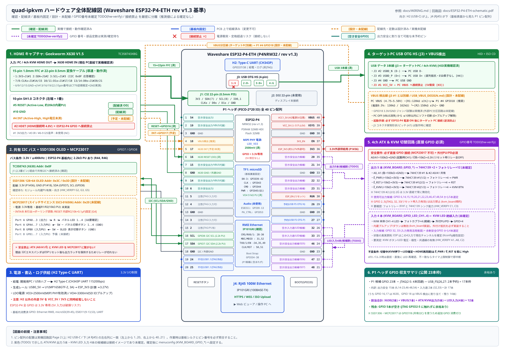
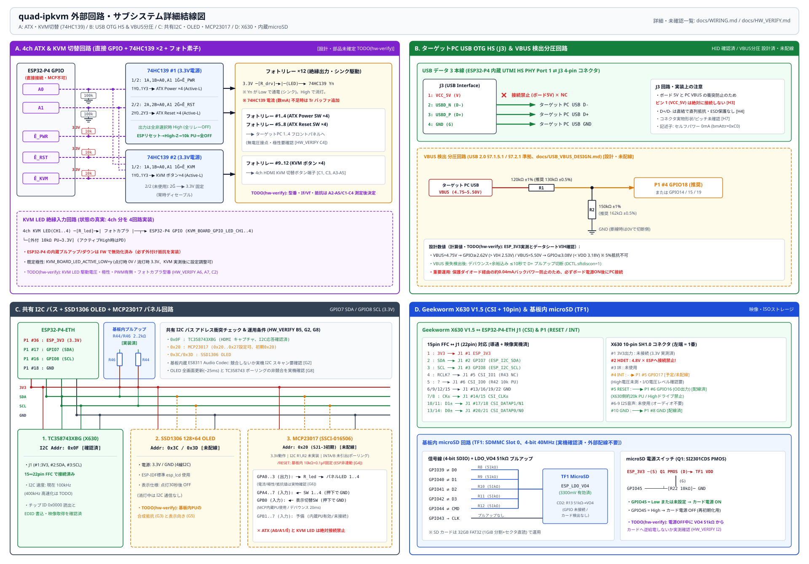

# ハードウェア全体配線図・ピン配列リファレンス (WIRING)

`quad-ipkvm`（Waveshare **ESP32-P4-ETH rev v1.3** + **Geekworm X630 V1.5** + 4ch HDMI KVM + ATX / パネル / OLED / VBUS 検出）の総合配線ガイドです。

- **一次資料**:
  - ボード回路図・実装図: [ESP32-P4-ETH-schematic.pdf](ESP32-P4-ETH-schematic.pdf)（Page 1: 回路図、Page 2〜3: シルク・部品実装図）
  - KiCad 回路図プロジェクト: [quad-ipkvm.kicad_pro](../hardware/kicad/quad-ipkvm.kicad_pro)（解説: [hardware/kicad/README.md](../hardware/kicad/README.md)）
  - 設計・決定事項: [HANDOFF.md](HANDOFF.md) / [PLAN.md](PLAN.md) / [USB_VBUS_DESIGN.md](USB_VBUS_DESIGN.md) / [OLED3_PLAN.md](OLED3_PLAN.md) / [ISO_MOUNT_DESIGN.md](ISO_MOUNT_DESIGN.md)
  - 実機確認記録・未確定一覧: [HW_VERIFY.md](HW_VERIFY.md) / [HW_STATE.md](HW_STATE.md)
  - GPIO 検証ロジック: [`components/kvm_board/kvm_board_logic.c`](../components/kvm_board/kvm_board_logic.c)、[`components/kvm_board/Kconfig`](../components/kvm_board/Kconfig)

> [!IMPORTANT]
> 本ドキュメントでは **推測や未確認の電気的数値を確定扱いしません**。未測の項目は **`TODO(hw-verify)`** として残し、[HW_VERIFY.md](HW_VERIFY.md) で確認した上で実配線を確定してください。

---

## 1. ステータス表記と色分け凡例

| ステータス表記 | 図中の色・線種 | 意味 |
|---|---|---|
| **`[確認・配線済]`** | 緑・実線 | 実機で接続および動作（導通 / I2C / CSI / USB 列挙等）を確認済み |
| **`[基板内固定]`** | 青・実線 | Waveshare ESP32-P4-ETH PCB 上で固定接続済み（変更不可） |
| **`[設計・未配線]`** | 橙・破線 | 接続先・定数・ソフトウェア設計は確定しているが、実機配線は未実施 |
| **`[未確定 TODO(hw-verify)]`** | 紫・破線 | GPIO 番号・部品型番・抵抗値等が実測・部品選定待ち |
| **`[接続禁止]`** | 赤 `✕` | 電源衝突・5V 耐圧超過による破損リスクがあるため**絶対に接続しない** |

---

## 2. 安全上の禁止事項（配線前に必読）

1. **`J3` ピン 1（`VCC_5V`）をターゲット PC の USB VBUS に繋がない**（`HW_VERIFY.md` H3）  
   `J3` のピン 1 は ESP32-P4-ETH 基板内部の 5V 電源です。ターゲット PC の 5V と直結すると 2 つの電源が衝突・逆流するため、**データ線 3 本（`2:D-`, `3:D+`, `4:GND`）のみ接続**し、ピン 1 は未接続（NC）にします。
2. **X630 V1.5 10 ピンコネクタ `#2 HDET` を ESP32-P4 GPIO に繋がない**（`HW_STATE.md` §1.3）  
   `HDET` は HDMI 接続時に **4.8 V** が出力されるため（ESP32-P4 の I/O は 3.3 V 専用・5 V 非トレラント）、接続禁止です。
3. **ATX / KVM 制御出力と KVM LED 入力は MCP23017 に置かず、必ず直接 GPIO を使う**（`PLAN.md` §4.4）  
   `MCP23017` は `/RESET` が商品（`SSCI-016506`）内部でプルアップ固定されており、ESP32-P4 リセット時も出力ラッチを保持し続けます（`HW_VERIFY.md` G4）。ATX の `A0/A1` と `Ē_PWR/Ē_RST/Ē_KVM` は直接 GPIO に繋ぎ、ESP リセット（High-Z）時に外付け **10 kΩ プルアップ**で確実に全リレー OFF にします。
4. **VBUS 分圧回路使用時は「ESP32-P4 電源 ON → ターゲット PC 接続」の順を守る**（`USB_VBUS_DESIGN.md` §3.1）  
   ESP32-P4 側が無電源の状態でターゲット PC の VBUS（5 V）が分圧回路に入ると、GPIO 保護ダイオード経由で `VDD` へ約 0.04 mA 回り込み半起動状態になり得ます。
5. **外部 5 V の二重給電を避け、GPIO に 3.3 V を超える電圧を入れない**  
   ボードへの給電は `H2`（Type-C UART）から行い、`P1 #39 (VSYS)` / `#40 (VBUS)` から別電源を混ぜないでください。`MCP23017` も **3.3 V** で駆動します。

---

## 3. 全体配線図・詳細結線図

### 3.1 全体配線図（システム構成と `P1` 40ピンヘッダ対応）



### 3.2 サブシステム別・詳細回路結線図



### 3.3 KiCad 回路図プロジェクト（KiCad 8 / 9 階層シート）

実配線・部品表・ERC 確認用の KiCad プロジェクトを [`hardware/kicad/quad-ipkvm.kicad_pro`](../hardware/kicad/quad-ipkvm.kicad_pro)（解説: [`hardware/kicad/README.md`](../hardware/kicad/README.md)）に格納しています。全 5 枚（A3 横）の階層シートで構成され、Page 1 ルートシート（`P1` 40pin / `J3`）から `USB_VBUS`、`X630_CSI`、`I2C_OLED_PANEL`、`ATX_KVM_CTRL` の各サブシートへ接続します。

---

## 4. Waveshare ESP32-P4-ETH `P1`（`PICO-2*20 IO`）全 40 ピン配列

`docs/ESP32-P4-ETH-schematic.pdf` Page 1（回路図ネットリスト）および Page 2（基板表面シルク図）の突き合わせ結果です。  
**ボードの向き**: 上辺に `H2`（Type-C UART）、下辺に `J4`（RJ45 Ethernet）を置き、表面（`J1`/`J2`/`J3` 側）を見たときの配置です。実配線時は基板シルク名と番号を必ず二重確認してください。

### 4.1 左列（Pin 1 〜 Pin 20、上から下）

| P1 Pin | 基板シルク | 回路図ネット名 | 用途・接続先 | 区分 / 状態 | 制約・備考 |
|---|---|---|---|---|---|
| **1** | `54` | `GPIO54` | **空き（安全出力可）** | `[空き安全GPIO]` | JTAG/ストラップ非該当 |
| **2** | `19` | `GPIO19` | **空き（安全出力可 / VBUS 代案）** | `[空き安全GPIO]` | `VDDPST_2` 領域 |
| **3** | `GND` | `GND` | 共通 GND | `[電源/GND]` | |
| **4** | `18` | `GPIO18` | **ターゲット PC VBUS 検出（推奨）** | `[設計・未配線]` | `CONFIG_USB_DEVICE_VBUS_SENSE_GPIO=18`。R1/R2 分圧必須（ジャンパ単体確認済） |
| **5** | `17` | `GPIO17` | **X630 `10pin #4 INT`（予定）** | `[設計・未配線]` | 入力予定（High 電圧未測定 `TODO(hw-verify)`） |
| **6** | `16` | `GPIO16` | **X630 `10pin #5 RESET`** | `[確認・配線済]` | `CONFIG_TC358743_RESET_GPIO=16`（オープンドレイン出力、Active-Low） |
| **7** | `15` | `GPIO15` | **空き（安全出力可 / VBUS 代案）** | `[空き安全GPIO]` | |
| **8** | `GND` | `GND` | **X630 `10pin #10 GND` / 共通 GND** | `[確認・配線済]` | X630 10pin と導通確認済み |
| **9** | `14` | `GPIO14` | **空き（安全出力可 / VBUS 代案）** | `[空き安全GPIO]` | |
| **10** | `6` | `GPIO6` | **空き（安全出力可）** | `[空き安全GPIO]` | |
| **11** | `5` | `GPIO5` | 注意（JTAG / 入力流用可） | `[注意・回避推奨]` | `kvm_board`: 出力禁止（`KVM_BOARD_ALLOW_JTAG_INPUTS=y` 時のみ LED 入力可） |
| **12** | `4` | `GPIO4` | 注意（JTAG / リセット時入力有効） | `[注意・回避推奨]` | 同上 |
| **13** | `GND` | `GND` | 共通 GND | `[電源/GND]` | |
| **14** | `3` | `GPIO3` | 注意（JTAG / リセット時入力有効） | `[注意・回避推奨]` | 同上 |
| **15** | `2` | `GPIO2` | 注意（JTAG / リセット時弱 PU+入力有効） | `[注意・回避推奨]` | 同上 |
| **16** | `SCL` | `ESP_I2C_SCL` (GPIO8) | **共有 I2C SCL（TC358743 / OLED / MCP23017）** | `[確認・配線済]` | 基板内 `R44 2.2kΩ → ESP_3V3` 実装済。`J1 #3` と共通 |
| **17** | `SDA` | `ESP_I2C_SDA` (GPIO7) | **共有 I2C SDA（TC358743 / OLED / MCP23017）** | `[確認・配線済]` | 基板内 `R46 2.2kΩ → ESP_3V3` 実装済。`J1 #2` と共通 |
| **18** | `GND` | `GND` | 共有 I2C / 外部モジュール GND | `[電源/GND]` | |
| **19** | `24` | `USB1P1_N` (GPIO24) | 使用不可（USB Serial/JTAG） | `[基板内固定]` | `kvm_board`: 固定予約 |
| **20** | `25` | `USB1P1_P` (GPIO25) | 使用不可（USB Serial/JTAG） | `[基板内固定]` | `kvm_board`: 固定予約 |

### 4.2 右列（Pin 40 〜 Pin 21、上から下）

| P1 Pin | 基板シルク | 回路図ネット名 | 用途・接続先 | 区分 / 状態 | 制約・備考 |
|---|---|---|---|---|---|
| **40** | `VBUS` | `VCC1_5V` | `H2` Type-C 給電入力側 5 V（AO3401/D2 手前） | `[電源]` | 外部電源との混在禁止 |
| **39** | `VSYS` | `VCC_5V` | システム 5 V レール | `[電源]` | 外部電源との混在禁止 |
| **38** | `GND` | `GND` | 共通 GND | `[電源/GND]` | |
| **37** | `EN` | `3V3_EN` | `U1 (MP1658GTF-Z)` イネーブル（`R21 100kΩ→VCC_5V`） | `[電源]` | 外部接続不要 |
| **36** | `3V3` | `ESP_3V3` | **3.3 V 出力（計算 ≈ 3.27 V）→ OLED / MCP23017 / PU 用** | `[電源]` | 外部モジュール（OLED / MCP23017 / フォト回路 PU）へ供給可 |
| **35** | `20` | `GPIO20` | **空き（安全出力可 → ATX/KVM 出力候補）** | `[未確定 TODO]` | `A0/A1/Ē_*` 出力候補。`J2` と共有表記なく独立（B1） |
| **34** | `21` | `GPIO21` | **空き（安全出力可 → ATX/KVM 出力候補）** | `[未確定 TODO]` | 同上 |
| **33** | `GND` | `GND` | 共通 GND | `[電源/GND]` | |
| **32** | `22` | `GPIO22` | **空き（安全出力可 → ATX/KVM 出力候補）** | `[未確定 TODO]` | 同上 |
| **31** | `23` | `GPIO23` | **空き（安全出力可 → ATX/KVM 出力候補）** | `[未確定 TODO]` | 同上 |
| **30** | `RUN` | `ESP_EN` (`CHIP_PU`) | ESP32-P4 チップリセット（`R34 10kΩ→3V3`） | `[電源/制御]` | パネル/外部リセット用途がなければ未接続 |
| **29** | `26` | `GPIO26` | 予約（USB 2.0 FS OTG `USB1P1_N1`） | `[基板内固定]` | `kvm_board`: 固定予約 |
| **28** | `GND` | `GND` | 共通 GND | `[電源/GND]` | |
| **27** | `27` | `GPIO27` | 予約（USB 2.0 FS OTG `USB1P1_P1`） | `[基板内固定]` | `kvm_board`: 固定予約 |
| **26** | `32` | `GPIO32` | **空き（入力専用推奨 → KVM LED 入力候補）** | `[未確定 TODO]` | リセット直後に入力有効。`kvm_board` では出力禁止 |
| **25** | `33` | `GPIO33` | **空き（入力専用推奨 → KVM LED 入力候補）** | `[未確定 TODO]` | 同上 |
| **24** | `46` | `GPIO46` | **空き（安全出力可 → ATX/KVM 入出力候補）** | `[未確定 TODO]` | 8-bit SDIO D5 既定（本機は 4-bit microSD のため使用可 [B1]） |
| **23** | `GND` | `GND` | 共通 GND | `[電源/GND]` | |
| **22** | `47` | `GPIO47` | **空き（安全出力可 → ATX/KVM 入出力候補）** | `[未確定 TODO]` | 8-bit SDIO D6 既定（使用可 [B1]） |
| **21** | `48` | `GPIO48` | **空き（安全出力可 → ATX/KVM 入出力候補）** | `[未確定 TODO]` | 8-bit SDIO D7 既定（使用可 [B1]） |

### 4.3 `P1` 空き GPIO 収支サマリ

| カテゴリ | GPIO 番号 | 本数 | 内訳・割当 |
|---|---|---|---|
| **P1 候補 GPIO 総数** | `2–6, 14–23, 26, 27, 32, 33, 46–48, 54` | **23 本** | 基板内非使用で `P1` に出ている候補（I2C `7/8` と USB1.1 `24/25` は除く） |
| 回避・予約ピン | `GPIO 2–5`（JTAG 4本）、`GPIO 26, 27`（USB_FS 2本） | **-6 本** | 上記 23 本から回避・予約分を除外（`24, 25` は P1 #19/#20 で常時使用不可） |
| **利用可能安全枠** | 出力可 `6, 14–23, 46–48, 54`（15本） + 入力適 `32, 33`（2本） | **17 本** | `23 − 4 − 2 = 17 本`（`PLAN.md` §4.4・`HW_VERIFY.md` B3 と一致） |
| 割り当て済み / 設計済み | `GPIO16` (X630 RESET `[済]`), `GPIO17` (X630 INT `[予定]`), `GPIO18` (VBUS 検出 `[推奨]`) | **-3 本** | 上記 17 本から使用/予定（残 14 本: 出力可 12本 + 入力適 2本） |
| **ATX / KVM 所要本数** | 出力 5 本（`A0, A1, Ē_PWR, Ē_RST, Ē_KVM`） + LED 入力 4 本（`CH1..4`） | **-9 本** | 出力 5 本は残り 12 本から、LED 入力 4 本は `32, 33` + 余剰安全ピン 2 本から選定 |
| **残余空き GPIO** | 割り当て後も未消費 | **5 本（＋回避 JTAG 4 本）** | I2C（OLED + MCP23017）は GPIO 7/8 共有のため追加 GPIO 消費ゼロ |

---

## 5. 基板内固定インターフェース一覧（変更不可）

すべて Waveshare `ESP32-P4-ETH` PCB 上で結線済みです（`docs/ESP32-P4-ETH-schematic.pdf` Page 1、`docs/HW_VERIFY.md` B1/F/I1、`components/net_eth/net_eth.c`、`components/iso_sd/iso_sd.c`）。

| 機能 | コネクタ / IC | 使用 GPIO / 電源 | 状態・備考 |
|---|---|---|---|
| **USB-C UART** | `H2` / `U4 (CH343P)` | `GPIO37 / GPIO38`（`CH343P` RXD/TXD）、保護 `TVS1` + `Q2`/`U2`/`D2` | `[基板内固定]` 書込・シリアルログ・5V給電。**USB-JTAG ではない** |
| **100M Ethernet** | `J4` / `U10 (IP101GRI)` | `GPIO28`(CRS_DV), `29`(RXD0), `30`(RXD1), `31`(MDC), `34`(TXD0), `35`(TXD1), `49`(TX_EN), `50`(RMII_CLK), `51`(PHY_RST), `52`(MDIO) | `[確認・基板内固定]` Link Up / HTTPS / WSS 実機確認済 |
| **microSD (4-bit)** | `TF1` + `Q1 (SI2301CDS)` | `GPIO39`(D0), `40`(D1), `41`(D2), `42`(D3), `43`(CLK), `44`(CMD), `45`(PMOS Gate + `R22 10kΩ→GND`) | `[確認・基板内固定]` `R8–R12 51kΩ → ESP_LDO_VO4 (3300 mV)`。CLK PU なし。CD2 は GPIO 未接続。40 MHz マウント確認済 |
| **Audio（未使用）** | `U9 (ES8311)` / `U11 (NS4150B)` | `GPIO9–13` (I2S)、`GPIO7/8` (I2C 共有)、`GPIO53` (`PA_CTRL`) | `[基板内固定]` 本プロジェクトでは未使用予約。I2C アドレス競合のみ `G2` で確認 |
| **Boot / Reset** | `Key1 (BOOT)` / `Key2 (RESET)` | `GPIO35` (BOOT), `CHIP_PU` (`ESP_EN`) | `[基板内固定]` ダウンロードモード切替 |
| **ストラップピン** | — | `GPIO34–38` | `[基板内固定]` 外部駆動不可 |
| **内部電源レール** | `U1 (MP1658GTF-Z)` / 内部 LDO | `ESP_3V3`（計算値 ≈ 3.27 V: `FB=0.8V, R18=40.2kΩ, R24=13kΩ`）、`LDO_VO3=2500mV`（`VDD_MIPI_DPHY`）、`LDO_VO4=3300mV`（SD IO PU） | `MIPI PHY` / `SD VO4` 有効化済。電圧直接測定は安全上の理由で未測（`E6/E14/I2`） |

---

## 6. サブシステム別配線詳細

### 6.1 HDMI キャプチャ: Geekworm X630 V1.5 (`TC358743XBG`)

#### (a) MIPI CSI-2 ケーブル（`X630 15pin 1.0mm` ↔ 変換 FFC ↔ `ESP32-P4-ETH J1 22pin 0.5mm`）

> ※ X630 の 15 ピン番号は GND（6, 9, 12, 15 番）のみ実測、信号番号は C779 型の逆順による `[推測]` ですが、FFC 導通確認と I2C (`0x0F`)・CSI 1080p30/720p60 映像キャプチャは実機確認済みです。

| X630 15-pin | 信号 | ESP `J1` (22-pin) | ESP32-P4 側ネット | 確認状況 |
|---|---|---|---|---|
| 1 | `3V3` | 1 | `ESP_3V3` | `[確認]` ケーブル 1→1 導通・動作済 |
| 2 | `SDA` | 2 | `ESP_I2C_SDA` (**GPIO7**) | `[確認]` 2→2 導通・I2C `0x0F` 応答 |
| 3 | `SCL` | 3 | `ESP_I2C_SCL` (**GPIO8**) | `[確認]` 3→3 導通・I2C 応答 |
| 4 | `REFCLK?` | 5 | `CSI_IO1` (`R43 NC` / GPIO 未接続) | `[推測]` |
| 5 | 不明 | 6 | `CSI_IO0` (`R42 10kΩ→ESP_3V3` / GPIO 未接続) | `[推測]` |
| 6 / 9 / 12 / 15 | `GND` | 13 / 16 / 19 / 22 | `GND` | `[確認]` 15→22 導通、X630 側 6/9/12/15 共通 |
| 7 / 8 | `CK_P` / `CK_N` | 14 / 15 | `CSI_CLKP` / `CSI_CLKN` | `[確認]` 映像受信で間接確認済 |
| 10 / 11 | `D1_P` / `D1_N` | 17 / 18 | `CSI_DATAP1` / `CSI_DATAN1` | `[確認]` 同上 |
| 13 / 14 | `D0_P` / `D0_N` | 20 / 21 | `CSI_DATAP0` / `CSI_DATAN0` | `[確認]` 同上 |

#### (b) X630 10-pin SH1.0 コネクタ（左端＝1 番）

| X630 10-pin | 信号名 | ESP32-P4 `P1` 接続先 | 方向・電気特性 | 状態 |
|---|---|---|---|---|
| 1 | `3V3`（出力） | 未接続（NC） | 3.3 V 実測済 | 未使用 |
| **2** | **`HDET`** | **絶対に繋がない** | **HDMI 接続時 4.8 V 出力** | **`[接続禁止]`** |
| 3 | `IR` | 未接続（NC） | — | 未使用 |
| **4** | **`INT`** | **`P1 #5` (`GPIO17`)** | Active-High（現在 **High 電圧未測定**） | `[設計・未配線]` `TODO(hw-verify)` |
| **5** | **`RESET`** | **`P1 #6` (`GPIO16`)** | Active-Low、Open-Drain 出力（X630 内蔵約 20 kΩ PU、High 駆動しない） | **`[確認・配線済]`** |
| 6〜9 | I2S 音声 | 未接続（NC） | — | 未使用 |
| **10** | **`GND`** | **`P1 #8` (`GND`)** | 基準 GND | **`[確認・配線済]`** |

---

### 6.2 ターゲット PC USB OTG HS（`J3` + VBUS 検出分圧）

```text
  [ESP32-P4-ETH J3 (4-pin)]                         [ターゲット PC / 4ch KVM USB]
   1: VCC_5V  ✕ ─────────────────────────── NC (絶対にPCのVBUSへ繋がない [H3])
   2: USBD_N  ───────────────────────────── D-
   3: USBD_P  ───────────────────────────── D+    ※ 直列抵抗・ESD保護なし [H4]
   4: GND     ───────────────────────────── GND

  [別線: USB 2.0 §7.2.1 準拠 VBUS 検出回路 (設計済・未配線)]
   ターゲット PC USB VBUS (4.75–5.50V)
        │
     [ R1: 120 kΩ ±1% (推奨 130 kΩ ±0.5%) ]
        │
        ├──────────────────▶ P1 #4 GPIO18 (推奨。代案: GPIO14 / 15 / 19)
        │                    (CONFIG_USB_DEVICE_VBUS_SENSE_GPIO=18)
     [ R2: 150 kΩ ±1% (推奨 162 kΩ ±0.5%) ]
        │
       GND  (未接続・断線時は 0 V となり安全側にソフト切断)
```

- **定数・条件**（`docs/USB_VBUS_DESIGN.md` §3.1 計算値、`TODO(hw-verify)`）:
  - 許容差 **1% 以下必須**（5% 品はウィンドウが成立しないため不可）。`ESP_3V3`（計算 ≈ 3.27 V）公差 ±5% を見込むなら **0.5% 品（`R1 = 130 kΩ` / `R2 = 162 kΩ`）推奨**。
  - `VBUS = 4.75 V` で `GPIO ≥ 2.62 V`（> `VIH` 最大 2.53 V）、`VBUS = 5.50 V` で `GPIO ≤ 3.08 V`（< `VDD` 下限 3.18 V）。
  - 関連 Kconfig: `CONFIG_USB_DEVICE_ENABLE=y`、`CONFIG_USB_DEVICE_BVALID_OVERRIDE=y`、`CONFIG_USB_DEVICE_VBUS_SENSE_GPIO=18`（現在ターゲット PC 接続時は 3 本線運用のため `-1`）、`CONFIG_USB_DEVICE_VBUS_POLL_MS=100`。
  - 動作確認済み範囲: `J3` 3 本線での HID 列挙・OS/BIOS 入力は確認済み。`GPIO18` ↔ `3V3`/`GND` 短絡ジャンパによるソフト着脱（`sftdiscon`）遷移も実機確認済み。ターゲット PC VBUS からの分圧回路実配線は未実施。

#### 6.2.1 VBUS 分圧の部品表・配線手順・確認手順（オーナー作業）

**部品表**（値は `USB_VBUS_DESIGN.md` §3.1 の計算。**1% 以下の抵抗が必須**で、5% 品は解がない）:

| 記号 | 推奨（0.5% の E96） | 代替（1% の E24） | 数 | 位置 |
|---|---|---|---|---|
| `R1` | **130 kΩ ±0.5%** | 120 kΩ ±1% | 1 | VBUS 側（PC の VBUS と GPIO18 の間） |
| `R2` | **162 kΩ ±0.5%** | 150 kΩ ±1% | 1 | GND 側（GPIO18 と GND の間） |

- `R1` と `R2` は、**必ず同じ組で使う**（130 kΩ + 162 kΩ、または 120 kΩ + 150 kΩ）。組を混ぜると、`USB_VBUS_DESIGN.md` §3.1 の余裕の計算が成り立たない。
- **オーナー決定（2026-11-26）: 0.5% の E96（`R1` = 130 kΩ、`R2` = 162 kΩ）を使う**。理由: `ESP_3V3` の許容差が未確認でも、余裕が大きい。
- 推奨は 0.5% の組。`ESP_3V3` の許容差（FB の基準電圧）が未確認なので、余裕が大きい（`VDD` ±5% で 0.045 V、1% の組は 0.03 V）。
- 定格電力は選ばなくてよい（最大でも 5.50 V ÷ 約 270〜290 kΩ のとき 0.11 mW 程度。**計算値**）。手配線なので、リード付きの金属皮膜の抵抗でよい。
- ほかに要るもの: ジャンパー線 2 本（`R1`/`R2` の中点 → `P1 #4`、`R2` の GND 側 → `P1 #3`）と、PC 側の USB ケーブルの VBUS 線（下の配線）。ESD の素子（`H4`）は、**オーナー決定（2026-11-26）: 足さない**（`J3` のデータ線・ピン 1 と、この VBUS 検出線〔GPIO のクランプ素子を含む〕のどちらにも足さない。このまま。VBUS 線は `R1` の 130 kΩ が直列抵抗を兼ねる。運用で、ケーブルを繋ぐ前に放電し、GND を最初に繋ぐ）。

**配線**（線は 3 本から 4 本になる）:
1. PC に繋ぐ USB ケーブルの **D−、D+、GND** は、従来どおり `J3` のピン 2、3、4 へ。
2. ケーブルの **VBUS（5 V、一般に赤）は、`J3` のピン 1 に繋がない**（`H3`）。`R1` の片方だけに繋ぐ。**VBUS の線の先は、ほかのどこにも触れないようにする**（絶縁する）。
3. `R1` のもう片方と `R2` の片方を繋ぎ、その中点を **`P1` の 4 番（GPIO18）** へ。
4. `R2` のもう片方を **`P1` の 3 番（GND。4 番の隣）** へ。
5. 電源の順序: **ボード（`H2` の Type-C）に先に給電してから、PC に繋ぐ**（`USB_VBUS_DESIGN.md` §3.1）。

**確認手順**（期待値は、すべて設計の計算値。実測と違ったら、`USB_VBUS_DESIGN.md` §3.1 の計算をやり直す）:

| # | 確認 | 手順 | 期待値 | 担当 |
|---|---|---|---|---|
| V1 | 抵抗の値と、分圧比（ボードに繋ぐ前） | テスターで `R1`、`R2` を測る。次に、5.0 V（USB 充電器など）を `R1` の VBUS 側と `R2` の GND 側に掛けて、中点の電圧を測る | 0.5% の組: 比 0.552〜0.557（5.0 V で 2.76〜2.79 V）。1% の組: 比 0.551〜0.561（5.0 V で 2.76〜2.81 V）。入力抵抗 10 MΩ のテスターは、約 1% 低く出る | オーナー |
| V2 | `ESP_3V3` の実測 | ボードに給電して、`P1` の 36 番（`ESP_3V3`）と GND の間を測る（`HW_VERIFY.md` E6 の一部） | 計算値 ≈ 3.27 V。±5%（約 3.11〜3.43 V）を外れたら、分圧の計算をやり直す。**結果（2026-11-26、オーナー）: 3.34 V。範囲内**（`USB_VBUS_DESIGN.md` §3.1 で余裕を再計算済み） | オーナー |
| V3 | 配線して、VBUS なしで起動 | `CONFIG_USB_DEVICE_VBUS_SENSE_GPIO=18` で書き込み、PC に繋がず（VBUS なし）に起動 | ログに、VBUS なし・切断（D+ のプルアップなし） | Antigravity |
| V4 | VBUS が入ったとき | ボードを入れたまま、PC に繋ぐ（または PC を ON） | デバウンス後に接続（`tud_connect`）。PC が HID を列挙する | Antigravity |
| V5 | **VBUS が切れたとき（仕様 §7.2.1 の 10 秒以内）** | PC を OFF にする（またはケーブルを抜く） | **10 秒以内に D+ のプルアップを切る**（ログの時刻と、PC を切った時刻から計る）。**時間を `HW_VERIFY.md` H5 に記録** | Antigravity + オーナー |
| V6 | 電源の順序が逆のとき（任意） | ボードを無電源のまま、PC の VBUS だけを入れ、`P1` の 36 番の電圧を見る | 上がらない（回り込みの約 0.04 mA で、半起動しない）。半起動するなら、運用で「ボード → PC」の順を必ず守る | オーナー |

V2 は、`HW_VERIFY.md` E6 の `ESP_3V3` の実測値の欄に、V5 は H5 の欄に書く。V1〜V5 が通れば、`GPIO18` の VBUS 検出は完了（H5 の `TODO(hw-verify)` を閉じる）。

---

### 6.3 共有 I2C バス＋SSD1306 OLED＋MCP23017 (`SSCI-016506`)

#### (a) 共有 I2C バス（3.3 V / ≤ 400 kHz）

- **信号線**: `P1 #17 SDA (GPIO7)` / `P1 #16 SCL (GPIO8)` / `P1 #36 3.3V (ESP_3V3)` / `P1 #18 GND`
- **プルアップ**: ESP32-P4-ETH 基板上に `R44` / `R46` **2.2 kΩ → `ESP_3V3`** 実装済み。
- **アドレス割当**:

| デバイス | I2C アドレス (7-bit) | 電源 | 状態 | 備考 |
|---|---|---|---|---|
| `TC358743XBG` (X630) | **`0x0F`** | 3.3 V (`J1 #1`) | `[確認・配線済]` | 現在 100 kHz で運用 |
| `SSD1306` OLED (128×64) | **`0x3C`** または **`0x3D`** | 3.3 V | `[設計・未配線]` | モジュール内蔵 PU の有無で合成抵抗を確認（`G3`） |
| `MCP23017` (`SSCI-016506`) | **`0x20`** (`0x20–0x27`) | 3.3 V | `[設計・未配線]` | 基板に `R1/R2` I2C PU パターンあるが未実装（`G1, G4`） |
| `ES8311` (基板内 Audio) | 未使用 (`G2` で要確認) | 3.3 V | `[基板内固定]` | アドレス競合しないか実機 I2C スキャンで確認 |

#### (b) `MCP23017`（スイッチサイエンス `SSCI-016506`）ピン割り当て（[`components/mcp23017_logic/include/mcp23017_logic.h`](../components/mcp23017_logic/include/mcp23017_logic.h)）

| MCP23017 ピン | 方向・プル設定 | 接続先 | 動作・備考 |
|---|---|---|---|
| `GPA0`..`GPA3` | 出力（プッシュプル） | パネル LED 1..4（電流制限抵抗経由） | 極性・抵抗値・電流合計は `HW_VERIFY G6` で確定 |
| `GPA4`..`GPA7` | 入力（内蔵 100 kΩ PU 有効） | パネル切替ボタン 1..4（押下で GND 落とし） | デバウンス 20 ms |
| `GPB0` | 入力（内蔵 100 kΩ PU 有効） | OLED 表示切替ボタン（押下で GND 落とし） | 押下で 30 秒再点灯 |
| `GPB1`..`GPB7` | 入力（内蔵 100 kΩ PU 有効） | 予備（未接続） | — |
| `INTA` / `INTB` / `/RESET` | — | **モジュールヘッダ未引出**（回路図 PDF `G4`） | 割り込み不可のため**ポーリング運用**。`/RESET` はモジュール内 `10 kΩ + 0.1 µF` 固定で ESP リセットと非連動（`G9` で影響確認） |

---

### 6.4 4ch ATX & KVM 切替回路（直接 GPIO + `74HC139 ×2`）

**原則（`docs/HANDOFF.md` §3.1〜§3.3、`docs/PLAN.md` §4）**:
- 「**KVM の LED を状態の真実とし、ATX の選択先はそれに追従する**」。
- **不変条件 4**: `A0/A1` を変える前には必ず `全 Ē を High → A0/A1 変更 → セットアップ待機 → 必要な Ē を Low` の順にする。

| 系統 | 信号 | 本数 | 接続先 | 外付け必須部品 | ESP32-P4 GPIO 候補 (`TODO(hw-verify)`) |
|---|---|---|---|---|---|
| 出力 | `A0`, `A1` | 2 | `74HC139 #1` & `#2` 共通アドレス | 各 **100 kΩ → GND**（起動時 CH1 確定） | `GPIO 6, 14, 15, 19, 20–23, 46–48, 54` から計 5 本選定 (`KVM_BOARD_GPIO_A0/A1`) |
| 出力 | `Ē_PWR` | 1 | `74HC139 #1` (1/2) `1Ḡ` → ATX Power フォトリレー ×4 | **10 kΩ → 3.3 V**（リセット時全 OFF） | 同上 (`KVM_BOARD_GPIO_E_POWER`) |
| 出力 | `Ē_RST` | 1 | `74HC139 #1` (2/2) `2Ḡ` → ATX Reset フォトリレー ×4 | **10 kΩ → 3.3 V** | 同上 (`KVM_BOARD_GPIO_E_RESET`) |
| 出力 | `Ē_KVM` | 1 | `74HC139 #2` (1/2) `1Ḡ` → KVM ボタン フォトリレー ×4 | **10 kΩ → 3.3 V**（`#2 (2/2) 2Ḡ` は 3.3 V 固定） | 同上 (`KVM_BOARD_GPIO_E_KVM`) |
| 入力 | `KVM_LED 1..4` | 4 | 4ch KVM LED → フォトカプラ ×4 → GPIO | **外付け 10 kΩ PU/PD 必須**（FW で内蔵プル無効） | `GPIO 32, 33` + 余剰安全 GPIO から 4 本 (`KVM_BOARD_GPIO_LED_CH1..4`) |

> [!CAUTION]
> `GPIO 2..5`（JTAG）と `GPIO 32, 33`（リセット時入力有効）は `components/kvm_board/kvm_board_logic.c` により**出力ピンとしてソフトウェア側で拒否**されます。`GPIO 32, 33` は `KVM_LED` 入力用に割り当てると無駄がありません。

---

## 7. 未確定・実機確認待ち項目 (`TODO(hw-verify)`)

配線・部品選定を進める際に [HW_VERIFY.md](HW_VERIFY.md) へ実測値を記録すべき項目です。

| 対象 | 確認項目 ID | 内容 | ブロッキング対象 |
|---|---|---|---|
| **4ch HDMI KVM** | `A1–A8`, `A10` | 型番・ボタン共通線の有無・開放電圧（3.3 V / 5 V）・LED 駆動電圧/極性・PWM 有無・手動切替再同期時間 | ATX / KVM 回路設計、A-9 / A-10 |
| **ATX 駆動・絶縁部品** | `C1–C7` | フォトリレー型番・`If/Vf`・74HC139 シンク可否（Tr バッファ要否）、フォトカプラ型番・抵抗値、`kvm_board` 無グリッチ / NVS 書込時 ISR 遅延測定 | 基板製作・`CONFIG_KVM_BOARD_ENABLE=y` 有効化（A-9） |
| **GPIO / I2C / OLED / MCP23017** | `B5`, `G1–G9` | `MCP23017` 現物での `INTA/B`・`/RESET` 確認、I2C スキャン（`ES8311` 等とのアドレス重複）、I2C 合成プルアップ抵抗、パネル LED 駆動電流、OLED 向き・I2C 干渉、`ESP` 再起動時の `MCP23017` 出力保持有無 | OLED-3c / OLED-4 |
| **X630 V1.5 & 電源** | `B6` (INT), `E6`, `E14` | X630 `10pin #4 INT` の High 電圧（GPIO17 接続可否）、`ESP_3V3`・消費電流実測（`VDD_MIPI_DPHY` 直接実測は狭ピッチ短絡リスクのため見送り中） | X630 INT 割り込み利用 |
| **USB OTG (`J3`) / VBUS** | `H4`, `H7`, `USB_VBUS` | `J3` 4pin コネクタの物理形状/ピッチ特定、ターゲット PC 側 VBUS 分圧抵抗の実装、`ESP_3V3` 実測とデータシート最終版 `VIH/VIL` 再照合、ESD 素子要否 | VBUS 連動切断の実配線（H5 完了） |
| **microSD / USB MSC (ISO)** | `I2`, `I4–I5`, `I8–I12` | 電源 OFF（`GPIO45=High`）時の `LDO_VO4` 51 kΩ からの逆給電有無、1 GiB パーツ読込・再ハッシュ速度、同時アクセス・差し替え書き込み柵試験 | A-13 後半 / A-14 / A-15 実機検証 |
